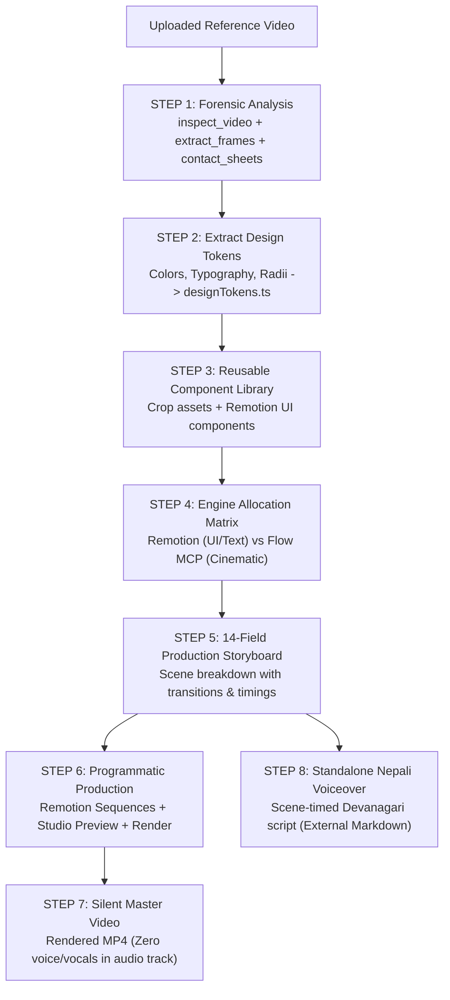

# Reference Video to Professional AI Video Production Skill
### *Autonomous Video Reverse-Engineering & Production System for Google Antigravity*

[](https://antigravity.google)
[](https://www.remotion.dev)
[](https://flow.google.com)
[](https://python.org)
[](https://ffmpeg.org)

An enterprise-grade **Google Antigravity Agent Skill** that reverse-engineers any uploaded reference video, extracts its visual design system and reusable UI assets, builds a complete 14-field production storyboard, and orchestrates an impressive new video combining **Remotion** (for programmatic UI and motion graphics) and **Google Flow MCP** (for cinematic AI b-roll).

---

## 📑 Table of Contents
1. [Overview & Philosophy](#-overview--philosophy)
2. [End-to-End Production Pipeline](#-end-to-end-production-pipeline)
3. [The 8 Production Phases](#-the-8-production-phases)
   - [Phase 1: Forensic Video Analysis](#phase-1-forensic-video-analysis)
   - [Phase 2: Visual Design System Extraction](#phase-2-visual-design-system-extraction)
   - [Phase 3: Reusable Assets & Component Contracts](#phase-3-reusable-assets--component-contracts)
   - [Phase 4: Responsibility Matrix (Remotion vs Google Flow)](#phase-4-responsibility-matrix-remotion-vs-google-flow)
   - [Phase 5: 14-Field Master Storyboard](#phase-5-14-field-master-storyboard)
   - [Phase 6: Video Composition & Rendering](#phase-6-video-composition--rendering)
   - [Phase 7: Audio Policy (Mandatory Silence)](#phase-7-audio-policy-mandatory-silence)
   - [Phase 8: Standalone Nepali Voiceover Script](#phase-8-standalone-nepali-voiceover-script)
4. [Included Python Automation Tools](#-included-python-automation-tools)
5. [Repository Structure](#-repository-structure)
6. [Installation & Setup](#-installation--setup)
7. [Invoking the Skill](#-invoking-the-skill)
8. [License](#-license)

---

## 🎯 Overview & Philosophy

Traditional generative AI video tools suffer from three fundamental flaws:
1. **Interface Hallucination**: AI video diffusion models cannot render sharp, readable software dashboards, typography, or UI controls without warping, jitter, or illegible text.
2. **Interface Drifting**: An application looks completely different from one scene to the next.
3. **Imprecise Animation Timing**: You cannot time button clicks or progress bars down to the exact millisecond using pure text prompts.

This skill solves all three problems by enforcing a strict **hybrid architectural division**:
* **Remotion**: Handles $100\%$ of readable application UI, screen recreations, cursor clicks, kinetic typography, motion graphics, charts, and final master MP4 rendering.
* **Google Flow MCP**: Generates photorealistic cinematic camera movements, real-world scenes, atmospheric lighting, and textured 3D environments.
* **The "Single Application" Invariant**: Extracted design tokens guarantee that every UI scene belongs unmistakably to the exact same software product.

---

## 🔄 End-to-End Production Pipeline



---

## 🎬 The 8 Production Phases

### Phase 1: Forensic Video Analysis
Never guess video properties or inspect a couple of random frames. The skill performs systematic analysis:
1. **Geometry Inspection**: Extracts resolution (16:9, 9:16, 1:1), frame rate, duration, and bitrates with [`inspect_video.py`](scripts/inspect_video.py).
2. **Frame Extraction**: Preserves original order and outputs an `index.json` linking each frame to exact timecodes with [`extract_frames.py`](scripts/extract_frames.py).
3. **Contact Sheet Inspection**: Packs frames into dense 4x4 visual grids with embedded timecode badges using [`generate_contact_sheets.py`](scripts/generate_contact_sheets.py) so agents and creators inspect visual changes in sequenced batches.
4. **Boundary Detection**: Uses FFmpeg scene score filters to map exact cut transitions with [`detect_scenes.py`](scripts/detect_scenes.py).

### Phase 2: Visual Design System Extraction
The reference's complete aesthetic is codified into reusable code:
* **Colors & Theme**: Primary, secondary, background, surface, and accent colors extracted via [`other_helpers.py palette`](scripts/other_helpers.py).
* **Typography**: Heading font families, weights, font size scales, tracking, and line heights.
* **Geometry**: Corner radii, borders, elevation, and drop shadows.
* **The "Single Application" Invariant**: Enforces that navigation headers, sidebars, active tab states, and branding stay unified across every single scene.

### Phase 3: Reusable Assets & Component Contracts
* Extracts critical UI elements (navbars, search inputs, charts, cards) using [`other_helpers.py crop`](scripts/other_helpers.py).
* Implements reusable Remotion React components (`<AppWindowContainer />`, `<SidebarNav />`, `<MetricCard />`, `<KineticTitle />`).
* Eliminates redundant ad-hoc styling by binding all components directly to `src/designTokens.ts`.

### Phase 4: Responsibility Matrix (Remotion vs Google Flow)
Every scene element is strictly assigned according to technology strengths:

| Video Element | Engine | Reason |
| :--- | :--- | :--- |
| **App Dashboards & UI Recreations** | **Remotion** | Vector-sharp, pixel-perfect, responsive. |
| **Cursor Clicks & State Changes** | **Remotion** | Exact millisecond timing and spring physics. |
| **Kinetic Titles & Text Overlays** | **Remotion** | Flawless web typography and character entrance. |
| **Charts & Data Sparklines** | **Remotion** | SVG path interpolation and dynamic counters. |
| **Cinematic B-Roll & Real-World Scenes**| **Google Flow MCP** | Photorealistic lighting, actors, physical spaces. |
| **Atmospheric Backgrounds & Particles** | **Google Flow MCP** | 3D volumetric light and organic movement. |
| **Hybrid Compositions** | **Hybrid** | Flow background clip + Remotion UI overlay on top. |
| **Master Timeline & Video Rendering** | **Remotion** | Frame-accurate sequence assembly and MP4 export. |

> [!CAUTION]
> **Strict Rule**: Never use Google Flow MCP or AI video generation for readable UI, buttons, or exact text. Remotion must always generate these elements.

### Phase 5: 14-Field Master Storyboard
Before coding, the entire project is planned using [`templates/storyboard.md`](templates/storyboard.md). Every scene documents 14 mandatory fields:
1. Scene Number
2. Start Timestamp & Frame
3. End Timestamp & Frame
4. Duration
5. Scene Description & Action
6. Visual Elements (foreground & background)
7. Text Displayed (headings & labels)
8. Required Animations & Spring Configs
9. Transition Type (Cut, slide, morph, zoom-blur)
10. Reference Frames
11. Reusable Components
12. Production Engine (Remotion / Google Flow / Hybrid)
13. Required Input Assets
14. Expected Output Assets

### Phase 6: Video Composition & Rendering
1. Generates atmospheric b-roll via authentic Flow MCP tools (`flow_generate`).
2. Moves downloaded clips into Remotion's `public/assets/` directory.
3. Constructs modular Remotion scenes using `<Sequence>`, `<AbsoluteFill>`, `spring()`, and `interpolate()`.
4. Launches Studio preview (`npx remotion studio --no-open`) to refine animation curves interactively.
5. Renders master MP4 using `npx remotion render src/index.ts Main out/video.mp4 --gl=angle`.

### Phase 7: Audio Policy (Mandatory Silence)
> [!IMPORTANT]
> **The default rendered video must be strictly SILENT.**
> * No AI narration.
> * No voiceover audio.
> * No spoken dialogue or vocals.
> * No generated speech inserted into the Remotion composition.

### Phase 8: Standalone Nepali Voiceover Script
A companion voiceover script is generated as a separate markdown document ([`templates/nepali-voiceover.md`](templates/nepali-voiceover.md)) for manual studio recording or dubbing:
* Written in authentic **Nepali Devanagari** (`नेपाली देवनागरी`).
* High-energy, conversational promotional tone.
* Attention-grabbing opening hook.
* Explains features and benefits matching each scene's timecode window.
* Closes with an engaging call-to-action.
* **Never inserted into the rendered video audio track.**

---

## 🛠️ Included Python Automation Tools

All scripts are located in [`scripts/`](scripts/) and require only standard Python 3.10+, FFmpeg, and Pillow:

```bash
# 1. Inspect technical metadata & aspect ratio:
python scripts/inspect_video.py path/to/video.mp4 -o metadata.json

# 2. Extract frames at 2 fps with index.json timecode mapping:
python scripts/extract_frames.py path/to/video.mp4 --fps 2 -o reference-assets/frames

# 3. Generate 4x4 contact sheets with timestamps:
python scripts/generate_contact_sheets.py --frames-dir reference-assets/frames --grid 4x4

# 4. Detect cuts and export scene keyframe stills:
python scripts/detect_scenes.py path/to/video.mp4 --save-stills -o scenes.json

# 5. Extract dominant HEX colors from a frame:
python scripts/other_helpers.py palette -i reference-assets/frames/frame_00001.png

# 6. Crop specific UI component:
python scripts/other_helpers.py crop -i frame_00001.png -b 100 40 800 60 -o reference-assets/navbar.png

# 7. Generate production TypeScript design tokens:
python scripts/other_helpers.py tokens -c "#0F172A,#3B82F6,#10B981,#F8FAFC" -o src/designTokens.ts
```

---

## 📂 Repository Structure

```
.
├── README.md                                        # Master documentation
├── skills-lock.json                                 # Agent skills lockfile
│
└── .agents/skills/
    ├── remotion-best-practices/                     # Official Remotion agent skill
    │   ├── SKILL.md
    │   ├── remotion-markup/
    │   ├── remotion-create/
    │   └── ...
    │
    └── reference-video-to-professional-video/       # Custom Video Production Skill
        ├── SKILL.md                                 # Skill router & execution protocol
        │
        ├── scripts/                                 # Production automation scripts
        │   ├── inspect_video.py
        │   ├── extract_frames.py
        │   ├── generate_contact_sheets.py
        │   ├── detect_scenes.py
        │   └── other_helpers.py
        │
        ├── references/                              # Architectural guides
        │   ├── video-analysis.md
        │   ├── visual-consistency.md
        │   ├── remotion-workflow.md
        │   ├── google-flow-workflow.md
        │   └── production-guidelines.md
        │
        ├── templates/                               # Standard production documents
        │   ├── storyboard.md
        │   ├── production-plan.md
        │   ├── scene-analysis.md
        │   └── nepali-voiceover.md
        │
        └── examples/
            └── example-project.md                   # Full end-to-end example walkthrough
```

---

## 🚀 Installation & Setup

### Option 1: In Google Antigravity
Clone directly into your Antigravity project root:
```bash
git clone https://github.com/nirajan-khatiwada/reference-video-to-professional-video.git .
```
Antigravity automatically discovers skills inside `.agents/skills/`.

### Option 2: Using the Skills CLI
```bash
npx skills add nirajan-khatiwada/reference-video-to-professional-video
```

### Prerequisites
* **FFmpeg & ffprobe**: Installed and available in system PATH.
* **Python 3.10+**: With `Pillow` installed (`pip install Pillow`).
* **Node.js 18+**: For Remotion Studio and rendering.
* **Google Flow MCP**: Connected via `flow-connector` (for AI b-roll generation).

---

## 💬 Invoking the Skill

In Google Antigravity chat, run:

```
/reference-video-to-professional-video
```

Or upload a video and instruct the agent:
> *"Analyze this reference video `input.mp4`, extract the design system, generate contact sheets, create the 14-field storyboard, and produce the video using Remotion and Google Flow MCP."*

---

## 📜 License

MIT License. Crafted with precision for Google Antigravity.
